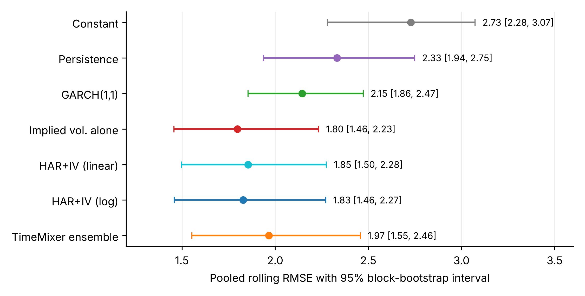

# EUR/USD realized-volatility forecasting: TimeMixer versus implied-volatility HAR

Does a lightweight multiscale neural network add value over a simple HAR regression that uses
implied volatility? This repository contains the code, forecasts and figures for a rolling
evaluation of **22-trading-day-ahead EUR/USD realized volatility** (September 2021 to September 2026).

> **Short answer:** not significantly. One-month implied volatility is very hard to improve on:
> a log-HAR model with implied volatility is statistically tied with it, and a TimeMixer
> ensemble trained on the same inputs is not significantly better than either.

Paper: *Does a lightweight multiscale model add value over implied-volatility HAR? A rolling
evaluation for EUR/USD realized volatility* (Shubhpreet Singh Verma, Jayesh Gangrade; STME, SVKM's NMIMS).

## Models and evaluation

| Group | Models |
|---|---|
| Benchmarks | training-mean constant, persistence, GARCH(1,1) |
| Regressions | HAR + implied volatility (linear and log) |
| Implied volatility | used directly as the forecast (added after the main design, so **post hoc / exploratory**) |
| Neural | TimeMixer (2 layers, `d_model` 8, 32,143 trainable parameters), 5-seed ensemble in the rolling test |

- **Target:** realized volatility over the next 22 trading days (annualised %), from daily log returns.
- **Features (7 groups):** 22-day realized volatility, Parkinson daily/weekly/monthly range volatility,
  one-month implied volatility, 10-day and 90-day historical volatility.
- **Single split:** 868 train / 164 validation / 164 test rows, with 22-day gaps between blocks.
- **Rolling evaluation (main result):** expanding window, 4 test blocks x 155 days = 620 days,
  all models re-estimated in every block.
- **Metrics and inference:** RMSE, MAE, QLIKE; Diebold-Mariano tests with the HLN correction
  (Bonferroni adjusted); moving-block bootstrap intervals; exact Shapley values and permutation importance.

## Main result (pooled rolling test, 620 days)

| Model | RMSE | MAE | QLIKE |
|---|---|---|---|
| Implied volatility alone (post hoc) | **1.798** | 1.425 | 0.145 |
| HAR + IV (log) | 1.828 | 1.440 | 0.152 |
| HAR + IV (linear) | 1.855 | 1.487 | 0.153 |
| TimeMixer ensemble (5 seeds) | 1.967 | 1.532 | 0.193 |
| GARCH(1,1) | 2.145 | 1.845 | 0.196 |
| Persistence | 2.332 | 1.860 | 0.329 |
| Constant (training mean) | 2.728 | 2.354 | 0.275 |

Paired RMSE differences with 95% block-bootstrap intervals: TimeMixer minus log-HAR 0.139
[-0.068, 0.391]; TimeMixer minus implied vol. 0.169 [-0.028, 0.394]; log-HAR minus implied vol.
0.030 [-0.037, 0.079]; GARCH minus implied vol. 0.348 [0.150, 0.549]. Only GARCH is clearly worse.

Implied volatility (38.7%) and weekly Parkinson volatility (28.8%) carry 67.5% of the TimeMixer
ensemble's Shapley attribution, so the network relies on the same signals as the HAR model.



## Repository layout

```
.
├── notebooks/
│   ├── 01_data_preparation.ipynb      Bloomberg exports -> features, target, split, windows
│   ├── 02_single_split_models.ipynb   benchmarks + TimeMixer on one split, tuning, test block
│   ├── 03_rolling_evaluation.ipynb    expanding-window evaluation and DM-HLN tests (main result)
│   └── 04_interpretability.ipynb      exact Shapley values and permutation importance
├── scripts/
│   ├── paper_figures.py               figures 1-6 of the paper
│   └── bootstrap_ci.py                bootstrap intervals, RMSE forest plot, seed analysis
├── results/                           forecasts, tables, trained weights, paper figures
├── data/                              Bloomberg data (not tracked, see data/README.md)
├── TimeMixer/                         reference implementation (git submodule)
├── requirements.txt
└── LICENSE
```

## Setup

```bash
git clone --recurse-submodules <this-repository-url>
cd <repository>
python3.12 -m venv venv && source venv/bin/activate
pip install -r requirements.txt
```

If you cloned without `--recurse-submodules`, run `git submodule update --init`.
The code runs on CPU; all reported results were produced on an Apple-silicon MacBook Air.

## Data

The raw series come from a Bloomberg Terminal and are **licensed, so they are not included**.
`data/README.md` lists the three Excel files, the Bloomberg tickers and fields, and the layout
the notebooks expect. Forecasts, tables and figures derived from them are in `results/`.

## Reproducing the results

1. Place the three Bloomberg exports in `data/`.
2. Run the notebooks in order (open them in VS Code or Jupyter; paths resolve from the repository root):
   `01_data_preparation` -> `02_single_split_models` -> `03_rolling_evaluation` -> `04_interpretability`.
3. Rebuild the paper figures:
   ```bash
   python scripts/paper_figures.py
   python scripts/bootstrap_ci.py
   ```

Seeds are fixed (0-9 for the single split, 0-4 per rolling block; bootstrap seed 42). The saved
forecasts in `results/` are the ones reported in the paper; re-running the neural models can
differ in the last digits across machines and PyTorch versions.

## Notes

- Sentiment features from GDELT were explored early on and dropped; that code is only in the
  first commit of the git history.
- The implied-volatility-alone benchmark and its five Diebold-Mariano comparisons were added after
  the study was designed and are labelled post hoc in the paper.

## Acknowledgements

TimeMixer: Wang et al., *TimeMixer: Decomposable Multiscale Mixing for Time Series Forecasting*,
ICLR 2024 ([kwuking/TimeMixer](https://github.com/kwuking/TimeMixer), Apache-2.0).

## License

Code in this repository is released under the MIT License (see `LICENSE`). The TimeMixer
submodule keeps its own Apache-2.0 license. Bloomberg data are not covered and not distributed.

## Authors

Shubhpreet Singh Verma (corresponding author) and Jayesh Gangrade, STME, SVKM's NMIMS, Madhya Pradesh, India.
